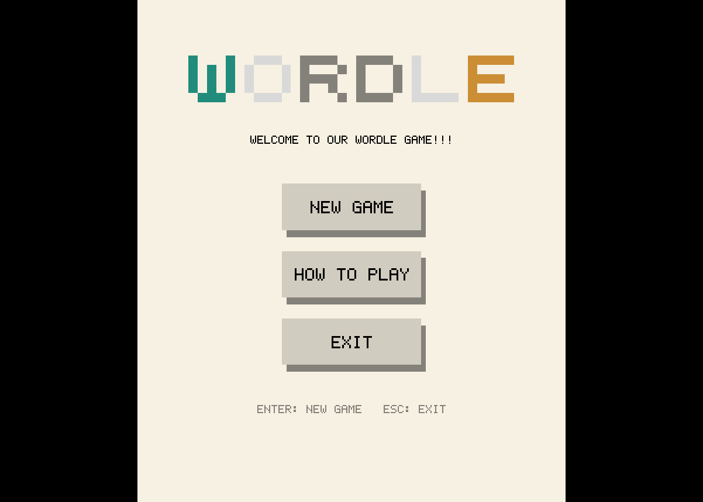
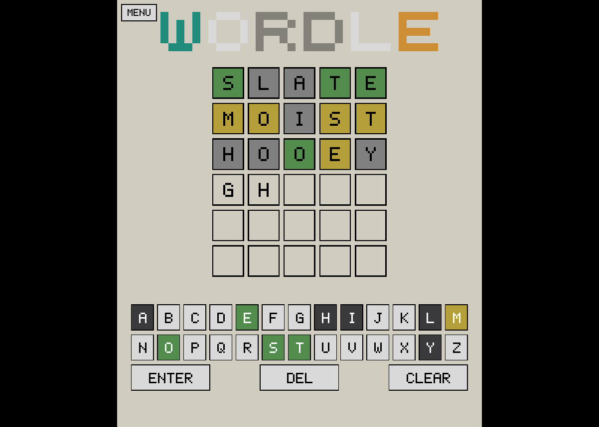
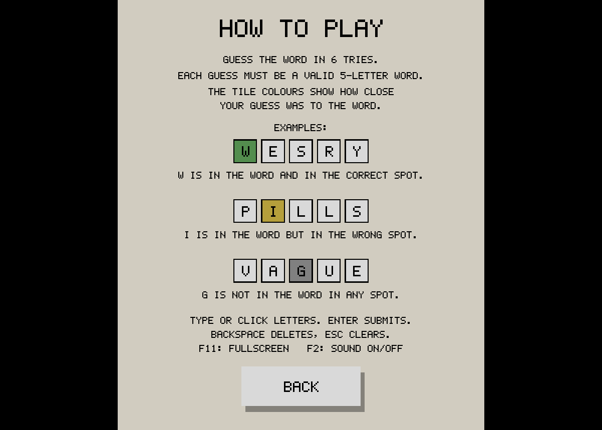
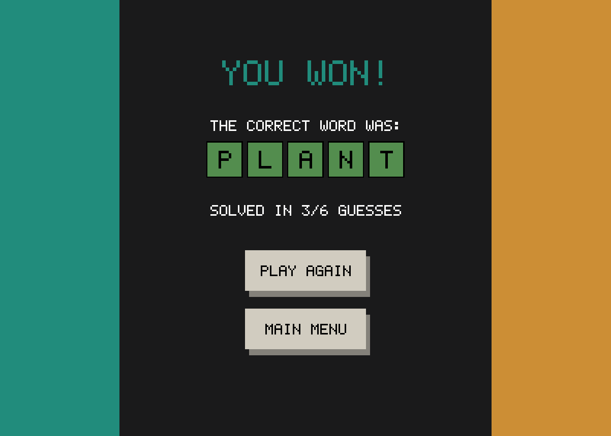

<p align="center">
  
</p>

# Wordle

A word-guessing game written in C with a pixel-art interface, drawn
directly with X11 on Linux. Guess the hidden five-letter word in six
tries; coloured tiles tell you how close each guess was.

The project started as a single Windows-only source file and was
rebuilt step by step into a small, tested, modular C program. The
history of that work is in the Git log, one commit per milestone.

## Screenshots

| Main menu | Playing |
|---|---|
|  |  |

| How to play | Result |
|---|---|
|  |  |

## Features

- Classic rules: green = right letter, right spot; yellow = in the word,
  wrong spot; grey = not in the word. Repeated letters are scored
  correctly (e.g. guessing `EERIE` against `CRANE` colours only one E).
- Play with the physical keyboard **or** by clicking the on-screen
  keyboard; keys change colour as you learn about each letter.
- **5,200 allowed guesses** and **2,176 possible answers**: answers are
  everyday words (no plurals or past tenses), while any of the 5,200
  words can be used as a guess.
- Clear feedback for guesses that are too short or not in the word list
  (they do not cost a turn).
- Main menu, How to Play, result screen with Play Again, and a goodbye
  screen.
- Pixel-art look: block logo, scalable 5×7 pixel font, raised buttons.
- 8-bit sound: looping chiptune music on the main menu, sounds for
  clicks, typing and deleting, a buzz for invalid guesses, one note per
  revealed tile (high = green, middle = yellow, low = grey), and win /
  lose tunes. Toggle with **F2** or the SOUND button on the menu.
- Works at any window size: the layout scales and stays centred;
  **F11** toggles fullscreen.
- Installs into the application menu with its own icon (`make install`).

## Requirements

- Linux with an X11 or Wayland desktop (Wayland runs it through
  XWayland, which Ubuntu includes)
- GCC, GNU Make, and the X11 and ALSA development headers
- Valgrind (optional, for the memory checks)

On Ubuntu / Debian:

```sh
sudo apt install build-essential libx11-dev libasound2-dev valgrind
```

Sound plays through ALSA, which PipeWire or PulseAudio route to your
speakers on a normal desktop. To build without sound (no ALSA headers
needed), add `NO_SOUND=1` to any make command, e.g. `make NO_SOUND=1`.
Run `make clean` when switching between the two.

## Build and run

```sh
git clone https://github.com/AshrafAzyz/Wordle.git
cd Wordle
make          # builds build/wordle
make run      # builds (if needed) and starts the game
```

The game finds its word lists relative to the program itself, so
`./build/wordle` works from any folder. If no audio device can be
opened, it prints `Sound disabled: ...` and plays silently.

## Install (optional)

```sh
make install      # for the current user, no sudo needed
make uninstall    # removes exactly what install added
```

This copies the game to `~/.local/bin/wordle`, the word lists (and
their licence) to
`~/.local/share/wordle/`, and adds a launcher with the Wordle icon to the
application menu. Use `make install PREFIX=/some/path` to install
elsewhere. If `~/.local/bin` is not on your `PATH`, start it from the
application menu instead.

## How to play

1. Choose **NEW GAME**.
2. Type a five-letter word (or click the letters) and press **Enter**.
3. Read the colours, then guess again. You have six tries.

| Key | Action |
|---|---|
| A–Z | Type a letter |
| Enter | Submit the guess / continue |
| Backspace or DEL | Delete the last letter |
| Esc or CLEAR | Clear the row (on the menu: exit) |
| F11 | Toggle fullscreen |
| F2 | Sound on / off |

## Project structure

```
wordle/
├── src/
│   ├── main.c         entry point; screen state machine and game flow
│   ├── game.c         game rules: scoring, turns, win/loss, keyboard state
│   ├── dictionary.c   loading, validating and looking up words
│   ├── ui.c           every screen, layout scaling, click hit-testing
│   ├── font.c         5×7 pixel-art font
│   ├── sound.c        synthesises all sound effects and the menu music
│   ├── audio.c        plays sound through ALSA on a background thread
│   ├── input.c        turns X11 events into game events
│   └── gfx.c          thin X11 layer: window, double-buffered drawing, events
├── include/           one header per module (its public interface)
├── tests/             unit tests, test data and manual X11 tests
├── data/
│   ├── words.txt          5,200 allowed guesses
│   ├── answers.txt        2,176 possible answers (all also in words.txt)
│   └── LICENSE-words.txt  licence for the word lists (SCOWL)
├── assets/            icon and application-menu entry
├── docs/              audit notes and screenshots
└── Makefile
```

How the modules depend on each other:

```
main ──► game ──► dictionary          (no X11: unit tested)
  ├────► dictionary
  ├────► input ──► gfx ──► Xlib
  ├────► ui ──► font ──► gfx
  │        └──► game (read only)
  └────► audio ──► sound              (sound: unit tested)
           └──► ALSA + a mixing thread
```

`game`, `dictionary` and `sound` never touch X11 or the sound card,
which is why they can be tested without a window or speakers. `audio`
mixes the music and up to 16 overlapping effects on its own thread;
the shared data is protected by a mutex. `ui` only draws and reports what was clicked;
`main` is the only module that changes game state.

## Word lists

- `data/words.txt` - every word accepted as a guess (5,200).
- `data/answers.txt` - the secret word is picked from here (2,176).

Both files hold one word per line. Lines that are not exactly five
letters A-Z are ignored, and lowercase is converted, so you can add
words with any text editor. Every answer must also be in `words.txt`;
`make test` checks this.

The lists combine the original 200 words with 5,000 words from
**SCOWL** (Spell Checker Oriented Word Lists) by Kevin Atkinson, as
packaged by Ubuntu (`wamerican`, `wamerican-small`, `wamerican-large`):
all common five-letter words (SCOWL sizes 35 and 50) plus an even
selection from size 70. Proper names, offensive words and slurs were
removed. Answers come from the most common tier (size 35), leaving out
likely plurals (`-S`, except words such as `BONUS` or `CHAOS`) and past
tenses (`-ED`, except words such as `GREED`).

## Testing

```sh
make test            # 40 unit tests, no display or speakers needed
make memcheck        # the same tests under Valgrind (fails on any leak/error)
make debug           # build with AddressSanitizer + UndefinedBehaviorSanitizer
make memcheck-game   # play the real game under Valgrind (audio muted, see below)
make manual-tests    # interactive X11 checks: build/test_gfx, build/test_input
```

The unit tests cover correct, wrong and partial guesses, repeated
letters, empty, short, long and lowercase input, the six-guess limit,
win and loss, keyboard colours, and dictionary loading failures
(missing, empty, unreadable, no valid words). They also include:

- a **differential test** comparing the scorer with an independent
  implementation on all 59,049 answer/guess pairs over three letters;
- **1,000 random games** checking rules that must always hold;
- a **100,000-word** generated dictionary;
- the real word lists: valid, sorted, no duplicates, and **every answer
  is also an allowed guess** (otherwise a game could be unwinnable);
- sound tests: every effect renders, is audible but not clipped, fades
  in and out (no clicks), and the tile notes have the right pitch
  (measured by counting zero crossings); the music loops seamlessly.

`make memcheck-game` sends audio to ALSA's null device
(`tests/alsa-null.conf`), because PipeWire's ALSA plugin keeps about
18 KB of its own memory after the device is closed. With the null
device the game ends with 0 bytes in use. The audio thread was also
checked for data races with GCC's ThreadSanitizer (`-fsanitize=thread`).

All code is compiled with `-std=c11 -Wall -Wextra -Wpedantic -Wshadow`
and builds without warnings.

## Known limitations

- **Linux only.** Graphics use Xlib directly. A Windows `.exe` would
  need a Windows version of `src/gfx.c` (Win32 or a library such as
  SDL); the game logic, dictionary and tests would not change.
- **Word lists are generated, not hand-checked.** The 2,176 answers and
  5,200 guesses come from SCOWL with automatic filters, so a few answers
  may be unusual words, and some rare words are still missing.
- **Random, not daily.** Each game picks a random word; there is no
  daily puzzle, statistics or streaks.
- No animations or hard mode. Sound has an on/off switch but no volume
  control (use the system volume).
- With PipeWire, Valgrind reports about 18 KB "definitely lost" inside
  PipeWire's ALSA plugin, allocated once when the sound device opens.
  It is not in this project's code (see Testing) and does not grow.
- English letters A–Z only. The on-screen keyboard is alphabetical
  (as in the original design), not QWERTY.
- On very small windows (minimum 320×360) the text becomes tiny.
- **Sound in virtual machines.** The menu music waits about one second
  after start-up, so the sound card can wake from power saving in
  silence. If sound still crackles in VirtualBox, set the VM's
  *Settings → Audio → Audio Controller* to **Intel HD Audio** (the older
  ICH AC97 controller is prone to stutter).
- Fullscreen depends on the window manager supporting the standard
  `_NET_WM_STATE_FULLSCREEN` request.

## Credits and licence

- `src/gfx.c` is based on the simple graphics library by **Douglas
  Thain** (CSE 20211, University of Notre Dame), later extended by
  Patrick Sebastian, and further changed for this project (double
  buffering, event handling, clean shutdown). The original header does
  not state a licence; its credits are kept in the file.
- **Sound effects and music** are original: they are synthesised at
  run time from simple waveforms by `src/sound.c` (the melody and every
  effect are written as tables in that file). No recorded audio,
  sample packs or third-party sound files are used, so no extra
  licence applies; they are covered by the MIT License below.
- **Word lists** (`data/words.txt`, `data/answers.txt`) are derived
  from **SCOWL**, Copyright 2000-2011 by Kevin Atkinson, which also
  includes material from Alan Beale's 12Dicts, WordNet 1.6 (Copyright
  1997 by Princeton University), the UK Advanced Cryptics Dictionary
  (Copyright J Ross Beresford 1993-1999) and Ispell (Copyright 1993
  Geoff Kuenning). Its permission notice and all required copyright
  notices are included verbatim in
  [`data/LICENSE-words.txt`](data/LICENSE-words.txt) and installed with
  the word lists. The lists are distributed under those terms, not
  under the MIT License.
- Everything else: © 2026 Ahmad Ashraf, released under the
  [MIT License](LICENSE).
